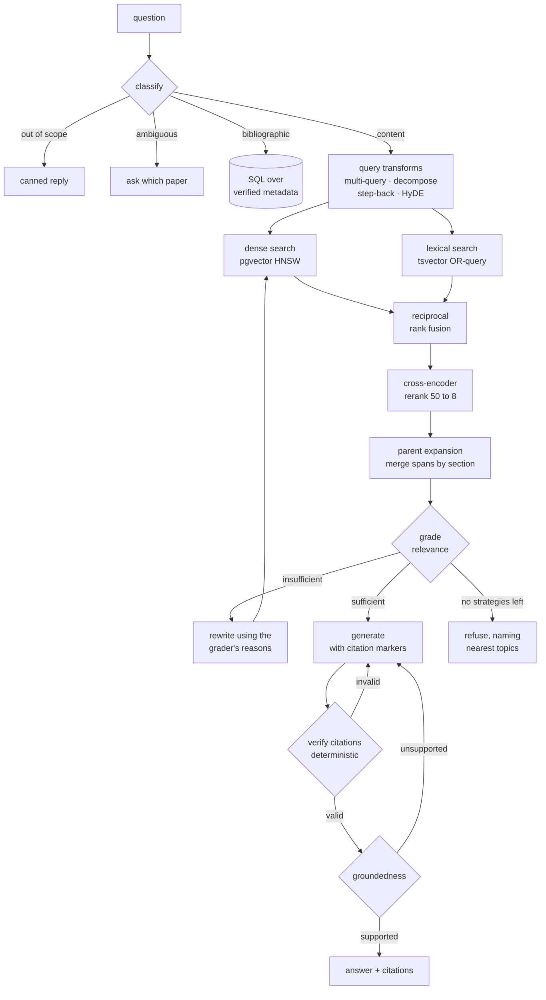

# myScholar-rag

A retrieval-augmented generation system over 20 of my own research papers, built
so that a visitor to my portfolio can ask about the work — and so that every
factual sentence in an answer is checkably traceable to a source.

The interesting part is not that it answers questions. It is what it does when
it cannot.

## Results

Measured on this corpus, reproducible from `scripts/`.

| Metric | Value | Basis |
|---|---|---|
| **Citation validity** | **100%** | 0 dangling markers of 20 emitted — enforced in code, not by prompting |
| **Over-refusal** | **0%** | 7 answerable control questions |
| Correct refusal | 76.9% | 13 questions the corpus genuinely cannot answer |
| Query classification | 93.5% | 46 questions; **100%** on the two classes where a misroute causes fabrication |
| Retrieval MRR | 0.872 | 37 questions, document-level, over the blocks a generator receives |
| Tests | 340 | unit + integration, including property tests |

**Read these as smoke tests with numbers attached.** Every one rests on fewer
than 50 examples, so a single question is two to eight percentage points. They
are enough to catch a broken component and not enough to rank two good ones.

The exception is citation validity, which is 100% *by construction* rather than
by sampling — every marker is checked against the retrieved set in code. If it
ever drops below 1.0, the verifier has a hole.

[`docs/AUDIT.md`](docs/AUDIT.md) is an independent pass over the whole build,
including the finding that classification accuracy was overfitted by 15 points
to its own test set.

## What makes it different from a naive RAG

Three specific failures, and what addresses each.

**It states things the sources don't support.** Every factual sentence must
carry a citation marker, and the markers are verified *in code* before the answer
is returned: the label must resolve to a block that was actually retrieved, and
any verbatim quote must really appear in it. A model asked "are your citations
valid?" is doing the same judgement that produced the invalid ones. A set lookup
is not.

**It answers confidently when it should decline.** Retrieval always returns
something — ask about a topic the corpus does not cover and you get the eight
least-irrelevant chunks. So retrieved passages are graded before generation, and
refusal is a terminal state with its own reason, carrying what the corpus *does*
cover rather than being a dead end.

**It invents answers to questions no passage can answer.** *"How many papers did
he publish in 2023?"* has no answer inside any paper — it is a property of the
collection. Those questions never reach the vector index; they compile to SQL
over human-verified metadata:

```
$ myscholar route "How many papers did he publish in 2023?"
  classification: bibliographic (decided by pattern)
  plan:           SQL over verified metadata — no vector search
  answer:         4 papers in 2023.
  classify 0ms · sql 2ms
```

## Architecture



Every loop is bounded by three independent budgets — steps, retrieval rounds and
wall clock — and termination is property-tested over random verdict sequences.

## Design notes

Written as the project was built, in [`docs/learning/`](docs/learning/). Each
explains a concept, what breaks without it, and what was measured.

| | |
|---|---|
| [00](docs/learning/00-architecture-and-ports.md) | Architecture, ports, and why abstraction is the deployment story |
| [00b](docs/learning/00b-running-services-without-root.md) | Running Postgres and Ollama with no root access |
| [01](docs/learning/01-chunking-and-embeddings.md) | Chunking and embeddings |
| [01b](docs/learning/01b-extraction-findings.md) | What PDF extraction actually produced — including a silent defect |
| [02](docs/learning/02-hybrid-search-and-reranking.md) | Hybrid search, fusion, and reranking |
| [04](docs/learning/04-query-translation-and-routing.md) | Query translation and routing |
| [05](docs/learning/05-adaptive-rag-and-hallucination.md) | The adaptive loop, and why it stops hallucination |

## Quick start

Nothing here needs root, Docker, or a GPU.

```bash
make setup                         # install dependencies (uv)
make test                          # 340 tests, no GPU or network
uv run myscholar ask "hello"       # walking skeleton, fake components
```

The default configuration uses fakes, so it runs anywhere. Copy `.env.example`
to `.env` for real models.

### With the corpus

```bash
make db-setup && make ollama-setup    # once
make up                                # start Postgres and Ollama
make ingest                            # extract, chunk, embed, index

uv run myscholar ask "How are weighting factors tuned?" --trace
uv run myscholar route "How many papers in 2023?"
uv run myscholar search "NSGA-II" --mode dense
```

`--trace` shows the path through the loop, which is the clearest way to watch it
work:

```
path: route -> grade -> generate -> verify -> generate -> verify -> done
      verifying   2 citation issue(s)
      verifying   citations valid
```

### Evaluation

```bash
make eval          # everything, writes results/report.md   (~30 min)
make eval-fast     # retrieval and routing only, deterministic  (~2 min)
```

Or one stage at a time:

```bash
uv run python scripts/eval_generation.py    # naive vs retrieved vs adaptive
uv run python scripts/eval_retrieval.py     # dense vs hybrid vs rerank vs routed
uv run python scripts/eval_routing.py       # classification accuracy
uv run python scripts/eval_generation.py --configs adaptive   # refusal only, faster
uv run python scripts/check_extraction.py   # PDF extraction sanity, ~20s
```

Results land in `results/` as markdown and JSON. `results/report.md` is the
consolidated one.

The `naive` configuration is a dense-only, single-call baseline,
implemented in `src/myscholar/evaluation/baseline.py` and run against the
*same* index, embedder and generator — so the difference between the rows is
pipeline design and nothing else. See
[docs/learning/06-evaluating-rag.md](docs/learning/06-evaluating-rag.md) for
why the baseline is deliberately made stronger than the original was.

## Stack

| | | |
|---|---|---|
| Generation | `qwen3:14b` via Ollama | Local GPU; swaps to a hosted API with one env var |
| Classification, grading | `qwen3:4b-instruct` | The `-instruct` suffix is load-bearing — see the config |
| Embeddings | `bge-base-en-v1.5` | Same weights at index and query time, asserted at startup |
| Reranking | `bge-reranker-base` | Cross-encoder over the top 50 |
| Store | PostgreSQL + pgvector | Dense, lexical and relational in one system |
| Framework | none | Hand-rolled, ~7,200 lines |

No LangChain. The adaptive loop is a 140-line state machine, which is what makes
its termination guarantee property-testable.

## Build phases

| Phase | Scope | State |
|---|---|---|
| 0 | Foundations: config, ports, fakes, CLI | done |
| 1 | Ingestion: parsing, sectioning, chunking, embedding | done |
| 2 | Retrieval: hybrid search, RRF, reranking, parent expansion | done |
| 3 | Query translation, routing, bibliographic SQL | done |
| 4 | Adaptive loop: grading, citation verification, refusal | done |
| — | Audit: 15 findings, 13 fixed | done |
| 6 | API, chat widget, conversation memory | done |
| 5 | Evaluation: three-pipeline comparison, per-claim faithfulness | done |
| 7 | Deployment: local containers, then free cloud | pending |

## Known limitations

Stated plainly rather than discovered later.

- **False premises are handled poorly — 1 of 4.** Asked *"in his 2023 paper he
  showed chaotic SVPWM increases EMI, why?"* (it reduces it), the system answers
  around the false premise instead of correcting it. Retrieval is right, the
  citations verify, the answer is grounded — it simply accepts a premise the
  source contradicts.
- **Dense-only retrieval beats hybrid on context precision** — 0.883 against
  0.66–0.71. The lexical branch earns its place on identifier queries such as
  `NSGA-II` and pays for it elsewhere. Unresolved without answer-quality
  measurement.
- **Every measurement uses fewer than 50 examples.**
- **Equations are extracted but excluded from embeddings.** The assistant
  discusses approaches, not formulae.
- **The Docker Compose file is untested**, because the development machine has
  no Docker. It ships for other people and is verified in Phase 7.


## Licence

MIT. The papers under `papers/` are not part of this repository and are not
redistributed.
